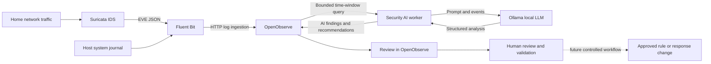

# Home Security Lab — v2.0
[](https://github.com/kbongcawel-viatrm/home-security.uk/actions/workflows/deploy-v2-stack.yml)

A self-hosted home-network security lab that combines Suricata network intrusion detection, centralized log collection, OpenObserve analytics, and local AI-assisted security analysis with Ollama.


> **Current status:** Minimum viable product (MVP). The system collects Suricata and host-journal events, stores them in OpenObserve, and periodically asks a local Ollama model to produce structured security findings and recommendations. The AI worker is advisory only; it does not change live rules or execute response actions.

## Overview

### Data flow



### Components

| Component | Role |
|---|---|
| **Suricata 8** | Host-managed IDS; inspects network traffic and writes EVE JSON events |
| **Fluent Bit** | Collects Suricata EVE JSON and host-journal records and forwards them |
| **OpenObserve** | Stores, searches, aggregates, and visualizes security events and AI recommendations |
| **Ollama** | Runs the selected local language model for private, local inference |
| **Security AI worker** | Queries a bounded recent event window, requests structured analysis, and writes recommendations to OpenObserve |

The current Compose stack is defined in [`v2.home-security.uk/compose.yaml`](v2.home-security.uk/compose.yaml). More operational details are in [`v2.home-security.uk/STACK.md`](v2.home-security.uk/STACK.md).

## Current MVP capabilities

- Collect Suricata EVE JSON logs from the host.
- Forward Suricata events and host-journal records through Fluent Bit.
- Search and aggregate records in OpenObserve.
- Periodically analyze a bounded batch of recent events with Ollama.
- Store structured AI findings, proposed changes, and confidence in the `ai_recommendations` stream.
- Keep model output advisory; proposed changes require human review and testing.
- Deploy the Compose stack through the repository's v2.0 workflow and verify core services.

OpenObserve is bound to localhost by default at `http://127.0.0.1:5080`. Ollama's API is internal to the Compose network and is not published to the host.

## Prototype

The current prototype is visible in OpenObserve's `ai_recommendations` stream. It shows stored AI analysis records, including summary, findings, proposed changes, model, and confidence fields.

The OpenObserve prototype currently displays the `ai_recommendations` stream with structured analysis records. The screenshot asset still needs to be added to the repository before it can be embedded directly in this README.

## Roadmap

### Phase 1 — Reliability and observability

- [ ] Fix and test event pagination, deduplication, and checkpoint handling so a busy time window cannot silently skip events.
- [ ] Monitor ingestion lag, dropped records, worker errors, and analysis-cycle duration.
- [ ] Add dashboards for alert signatures, source/destination IPs, protocols, event rates, and severity.
- [ ] Add freshness checks to confirm Suricata logs are reaching OpenObserve.
- [ ] Validate model output against a JSON Schema and handle malformed or incomplete responses safely.

### Phase 2 — Better AI analysis

- [ ] Correlate related alerts into incidents with stable incident IDs and timelines.
- [ ] Provide evidence references and alternative benign explanations for findings.
- [ ] Track recommendations as new, accepted, rejected, or false positive.
- [ ] Avoid repeatedly emitting the same recommendation when no material evidence has changed.
- [ ] Generate daily or weekly summaries of meaningful activity and unresolved findings.

### Phase 3 — AI-assisted detection engineering

- [ ] Have Ollama propose Suricata rules based on recurring, evidence-backed traffic patterns.
- [ ] Store proposals separately from live rules, with rationale, source events, false-positive risks, and test cases.
- [ ] Validate rule syntax and replay representative PCAPs or test traffic.
- [ ] Require review and a version-controlled change before deployment.
- [ ] Measure detection effectiveness and false positives; retain a rollback procedure.

### Phase 4 — Controlled response

- [ ] Add a response queue for proposed actions, evidence, expiry, approval, and execution status.
- [ ] Start with manual approval for temporary IP containment.
- [ ] Enforce allowlists, trusted/local-address exclusions, rate limits, expiry, audit logging, and rollback.
- [ ] Consider narrowly scoped automation only after evaluation demonstrates acceptable accuracy.

## Tentative feature ideas

- **AI-assisted threat correlation:** combine repeated signatures, ports, DNS activity, source addresses, and time windows into one incident.
- **Network behavior baselines:** identify unusual changes in device behavior, connection rates, destinations, or protocols.
- **Threat-intelligence enrichment:** enrich indicators with reputable IP/domain reputation, ASN, and threat-feed context, recording source and retrieval time.
- **Investigation playbooks:** suggest evidence-based steps for examining related events and affected devices.
- **MITRE ATT&CK mapping:** suggest likely tactics and techniques with supporting evidence and uncertainty; do not treat a mapping as proof.
- **Natural-language queries:** translate approved operator questions into validated, read-only OpenObserve queries with bounded time ranges and result sizes.
- **Model evaluation:** compare local models using a fixed event corpus and measure evidence accuracy, JSON validity, false-positive reasoning, latency, and resource use.
- **Recommendation feedback:** use operator decisions and test outcomes to improve prompts, thresholds, and test fixtures.

## Maximizing AI safely

Use a hybrid approach: deterministic code performs counting, aggregation, thresholding, schema validation, allowlist checks, and policy enforcement; Ollama interprets context, explains patterns, prioritizes investigations, and drafts proposals.

**Never allow raw log content or unvalidated model output to become a privileged command.** Treat event contents as untrusted data. Keep the AI worker unprivileged, and place any future firewall, Fail2Ban, or rule-deployment capability behind a separate, narrowly scoped response service.

For generated Suricata rules, use a proposal → syntax validation → traffic testing → human review → version-controlled deployment → monitoring/rollback workflow.

For IP containment, require evidence-backed policy checks, trusted-address exclusions, temporary expiry, audit records, and human approval during initial rollout. Fail2Ban is designed around log-driven jails; network IDS alerts should not be blindly piped into bans.

## Operational notes

- Suricata is installed and managed natively on the host as `suricata.service`; it is not installed by the Compose stack.
- The AI worker analyzes a bounded recent window and caps events per batch. Checkpointing, pagination, and deduplication should be tested carefully before using recommendations for response actions.
- Keep secrets in the protected host environment file; never commit `.env` or credentials.
- Pin and test container image versions before production use.
- Back up named volumes and test restores. Avoid `podman-compose down -v` unless you intentionally want to delete persistent data.

## Repository layout

```text
v2.home-security.uk/
├── compose.yaml
├── STACK.md
├── fluent-bit/
│   └── fluent-bit.conf
├── scripts/
│   └── host-exec.sh
└── security-ai/
    ├── Dockerfile
    └── worker.py
```

## Disclaimer

This is a home-lab security project for monitoring and defensive analysis. AI findings are hypotheses that require validation, not authoritative proof of compromise. Keep response actions reviewable, least-privileged, logged, and reversible.

## Intellectual Property and Usage Notice

Copyright © 2026 Kevin Agustin Bongcawel. All rights reserved, except where otherwise stated.

Unless expressly identified as third-party material or otherwise licensed, the original source code, documentation, architecture diagrams, project-specific configurations, and other original materials in this repository are the intellectual property of the project author.

**No license is granted** to reproduce, redistribute, modify, sublicense, or commercially exploit these materials, except as permitted by applicable law or expressly authorized in writing by the rights holder.

Public availability of this repository does not constitute a general grant of intellectual property rights or permission to use the project in a commercial product.

The project's name, branding, original implementation, and documentation are not offered for unrestricted commercial reuse. Third-party components, dependencies, tools, and referenced technologies remain subject to their respective owners' rights and licenses.

The general concepts and ideas described in this project are not claimed as exclusively owned merely by being documented here. This notice does not assert rights over third-party intellectual property or ideas and methods that are not protectable under applicable law.

For commercial licensing, partnership, or other authorized use, please contact the project author to discuss written permission and appropriate terms.

This project is under active development. No warranty is provided unless expressly required by applicable law or agreed in writing.
